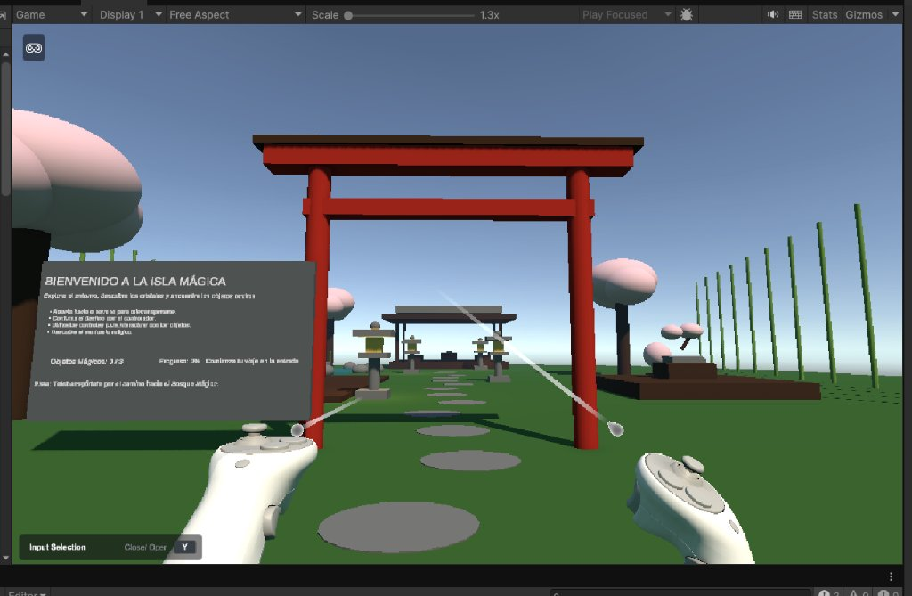
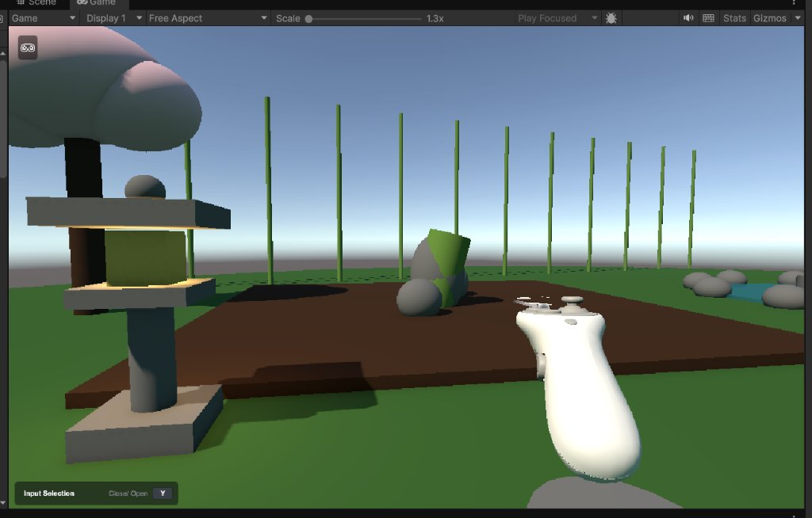
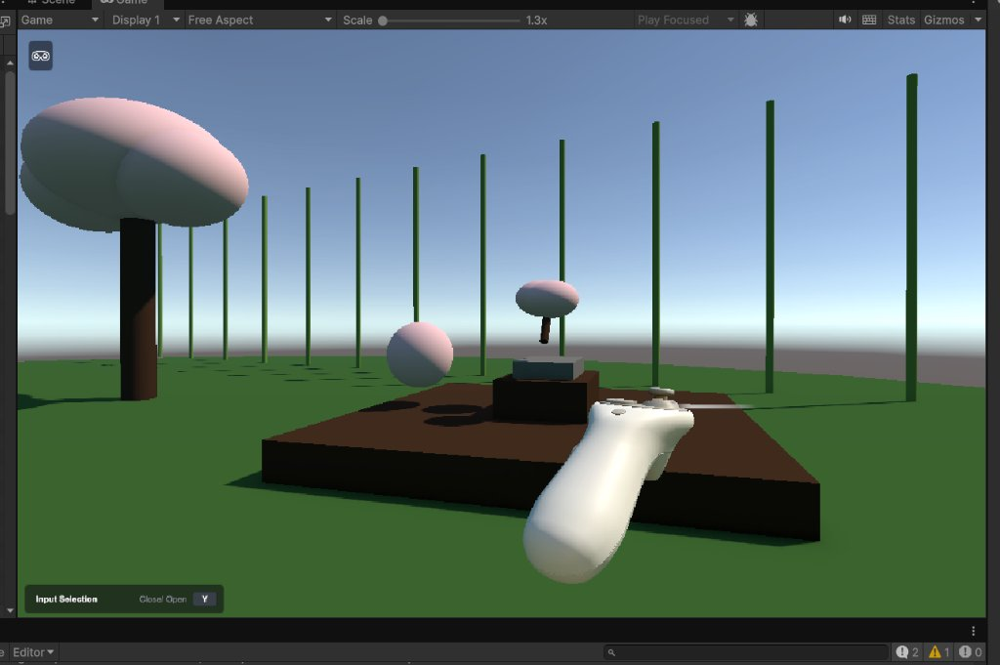
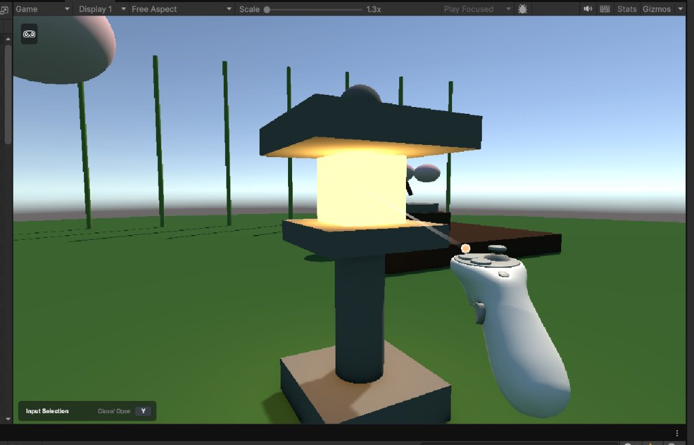
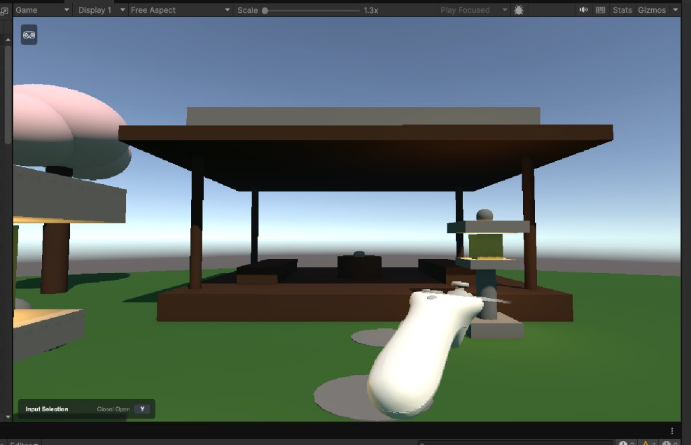

# Zen Garden VR: Japanese Kyoto Experience (Interactive Edition)

[](https://unity.com/)
[](https://unity.com/srp/Universal-Render-Pipeline)
[](https://docs.unity3d.com/Packages/com.unity.xr.interaction.toolkit@3.6/manual/index.html)
[](https://www.khronos.org/openxr/)

An immersive and contemplative Virtual Reality experience set in an authentic **traditional Japanese Zen Garden inspired by Kyoto's historic temples**, developed in **Unity 6 (6000.6.8f1)** utilizing **Universal Render Pipeline (URP 17.6.0)**, **OpenXR**, and the **XR Interaction Toolkit (XRI 3.6.1)**.

This edition substantially enhances visual aesthetics, architectural authenticity, and interactive mechanics, combining classic landscape elements (Torii gate, Tōrō stone lanterns, Karesansui dry raked sand garden, Tsukubai water fountain, cherry blossom bonsai, and contemplation tea pavilion) with 4 custom VR interaction mechanics, emissive visual highlight feedback, and an integrated World Space UI.

> 🇪🇸 **Nota en Español:** Para la versión completa de esta documentación en español, consulta [README_ES.md](README_ES.md).

---

## 1. In-Game Experience Gallery

The following screenshots document real-time execution in **Unity 6**, showcasing the visual Kyoto ambiance, comfort locomotion, interactive objects, and World Space interface:

| 1. Traditional Entrance with Torii Gate & Welcome Board | 2. Karesansui Dry Sand Garden & Master Rocks |
|:---:|:---:|
|  |  |

| 3. Sakura Cherry Blossom Bonsai Pavilion | 4. Illuminated Tōrō Stone Lantern Avenue |
|:---:|:---:|
|  |  |

| 5. Zen Contemplation & Tea Ceremony Pavilion |
|:---:|
|  |

---

## 2. Kyoto Zen Garden Zones

The 3D environment was designed around an organic, harmonic color palette (moss green, raked beige sand, aged dark timber, Kyoto river stone, and traditional vermilion red accents):

1. **Zone 1: Traditional Torii Entrance:**
   * Grand Japanese vermilion Torii gate featuring authentic Kasagi and Nuki timber beams.
   * Central stepping-stone pathway (*Tobi-ishi*) guiding the player smoothly across all garden zones.
   * Rustic wooden billboard with World Space UI positioned ergonomically beside the gate.
2. **Zone 2: Karesansui Raked Sand Garden (Dry Landscape):**
   * Enclosed by dark weathered timber beams.
   * Sand bed adorned with concentric raked wave ripples.
   * Three-stone harmonic composition (*Sanzon Iwagumi*).
   * **Special Interaction 1:** Sacred Zen stone with physical grabbing (`XRGrabInteractable`) and magnetic placement onto the ceremonial sand circle.
3. **Zone 3: Century-Old Sakura Bonsai Pavilion:**
   * Elevated timber platform with display table and ceramic tray.
   * **Special Interaction 2:** Sakura bonsai tree with organic breeze swaying and contemplation trigger.
4. **Zone 4: Tōrō Stone Lantern Avenue:**
   * Four classic carved stone lanterns placed purposefully along the walkways.
   * **Special Interaction 3:** Interactive lantern featuring permanent toggling of warm point illumination and incandescent flame core.
5. **Zone 5: Tsukubai Water Pond & Fountain (Shishi-odoshi):**
   * Pond featuring translucent water with real-time reflections under URP.
   * River stone perimeter boundary preventing accidental locomotion into the water.
   * **Special Interaction 4:** Ritual bamboo water spigot that toggles water stream flow and relaxing ambient sound.
6. **Zone 6: Contemplation & Tea Ceremony Pavilion:**
   * Spacious timber deck under a traditional Japanese pagoda roof.
   * Low meditation benches and a ceremonial tea bowl on a central cedar table.
7. **Perimeter Nature & Atmosphere:**
   * Natural bamboo forest fence and blooming Sakura cherry blossom trees.

---

## 3. VR Interaction System (4 Implemented Mechanics)

All interactive elements feature **visual hover highlighting (`ObjectHighlight.cs`)**, **cultural object inspection cards (`ObjectSelectionManager.cs`)**, and audio feedback:

| Object | XR Component | Interaction Type | Mechanic & In-Game Response |
|---|---|---|---|
| **Sacred Zen Stone** | `XRGrabInteractable` | Direct / Ray Grab | Physics-based grab with gravity. Releasing it over the ceremonial sand circle smoothly snaps it into place, plays a harmonic chime, and updates the discovery counter. |
| **Tōrō Stone Lantern** | `XRSimpleInteractable` | Ray / Direct Trigger | Aiming the ray and pressing the trigger button permanently toggles the warm amber light (2.2 lux) and flame core emission. |
| **Sakura Bonsai Tree** | `XRSimpleInteractable` | Ray / Direct Trigger | When selected, plays a Japanese meditation chime, triggers organic swaying, and updates the UI with contemplation wisdom. |
| **Tsukubai Fountain** | `XRSimpleInteractable` | Ray / Direct Trigger | When activated, pivots the bamboo lever and alternates the tranquil water flow. |

---

## 4. VR Locomotion & Comfort (Anti-Nausea)

- **Primary Locomotion:** Parabolic arc teleportation mapped across 19 stepping-stone surfaces and resting decks (`TeleportationArea`).
- **Discrete Rotation (Snap Turn):** Instantaneous 45-degree angle rotation eliminating motion sickness and vestibular dissonance.
- **Player Orientation:** Preserves upright vertical camera alignment (`MatchOrientation.WorldSpaceUp`).
- **XR Interaction Simulator:** 100% pre-configured and operational for immediate testing inside the Unity Editor with keyboard and mouse.

---

## 5. World Space Graphical Interface (VR UI)

A rustic wooden billboard integrated naturally near the Torii entrance without obstructing player navigation:
- **Zen Header:** "KYOTO ZEN GARDEN".
- **Mission & Lore:** Meditative guidance for discovering garden elements.
- **Dynamic Inspection Card:** Shows the target object's title, cultural description, and active controls when hovered.
- **Harmony Counter:** Live tracking of discovered interactive elements `(0 / 4)`.
- **Notification Feed:** Fleeting confirmation banners upon completing interactions.

---

## 6. Technical Specifications

- **Game Engine:** Unity Editor 6000.6.8f1 (Unity 6).
- **Render Pipeline:** Universal Render Pipeline (URP 17.6.0).
- **XR Framework:** XR Interaction Toolkit 3.6.1 & XR Core Utils 2.6.0.
- **XR Provider:** OpenXR Plugin 1.18.0.
- **Input System:** Unity Input System 1.20.1 (Action-Based Controllers).
- **UI & Typography:** UGUI 2.6.0 with TextMesh Pro.

---

## 7. Project Architecture

```
Assets/
  Scenes/
    MainVRScene.unity                    <-- PRIMARY KYOTO ZEN GARDEN SCENE
    MainVRScene_MagicalIsland_Backup.unity
  Scripts/
    Interactions/
      ObjectHighlight.cs                 <-- Emissive material highlight on hover
      ObjectSelectionManager.cs          <-- Dispatches inspection metadata to UI
      ZenStoneInteraction.cs             <-- Physical grab and circle snapping
      BonsaiInteraction.cs               <-- Bonsai contemplation and swaying
      LanternInteraction.cs              <-- Tōrō lantern light toggling
      FountainInteraction.cs             <-- Tsukubai bamboo flow control
      VRInteractionUI.cs                 <-- World Space Canvas UI controller
    Environment/
      AmbientAudioController.cs          <-- Ambient water and breeze audio
      EnvironmentEffects.cs              <-- Organic foliage swaying
      WaterController.cs                 <-- Pond surface wave distortion
  Materials/ZenGarden/
    M_ZenSand.mat                        <-- Karesansui dry raked sand
    M_ZenMoss.mat                        <-- Traditional Kyoto moss grass
    M_ToriiRed.mat                       <-- Japanese vermilion lacquer
    M_ZenWoodDark.mat                    <-- Weathered cedar timber
    M_ZenBamboo.mat                      <-- Natural green bamboo stems
    M_ZenStoneGray.mat                   <-- River stone & carved lantern gray
    M_SakuraPink.mat                     <-- Cherry blossom canopy & petals
    M_ZenWaterPond.mat                   <-- Translucent pond water
    M_ZenLanternFlame.mat                <-- Incandescent lantern flame core
    M_ZenWhitePebble.mat                 <-- White garden pebbles
  Editor/
    ZenGarden/ZenGardenBuilder.cs        <-- Procedural scene layout tool
```

---

## 8. Execution Instructions & Controls

1. Open the project in **Unity 6000.6.8f1**.
2. In the **Project** window, open: `Assets/Scenes/MainVRScene.unity`.
3. Press **Play (▶)**:

### With VR Headsets (Meta Quest 2 / 3 / Pro, HTC Vive, Valve Index):
* **Teleportation:** Push the thumbstick forward to project the parabolic arc onto stones or grass, then release to teleport.
* **Turn:** Flick the right thumbstick left or right for 45° Snap Turn.
* **Interact (Lantern / Bonsai / Fountain):** Aim the ray interactor and pull the **Trigger** button.
* **Grab Zen Stone:** Bring the controller near or ray-target the stone, hold the **Grip** button to lift, move over the sand circle, and release Grip.

### On PC via XR Interaction Simulator (Keyboard & Mouse):
* **Look Around:** Hold **Right Mouse Button** and move the mouse.
* **Teleportation:** Hold the **`B`** key, aim at the pathway or lawn, and Left Click / release `B`.
* **Rotate View:** Press **`Q`** and **`E`** (45° Snap Turn).
* **Aim Controller Ray:** Hold **`Left Shift`** and move the mouse to position the simulated controller.
* **Interact (Trigger):** While aiming with `Left Shift`, **Left Click** on the lantern, bonsai, or fountain.
* **Grab Zen Stone (Grip):** Aim at the stone with `Left Shift`, hold the **`G`** key to lift it, move over the sand circle, and release `G`.
