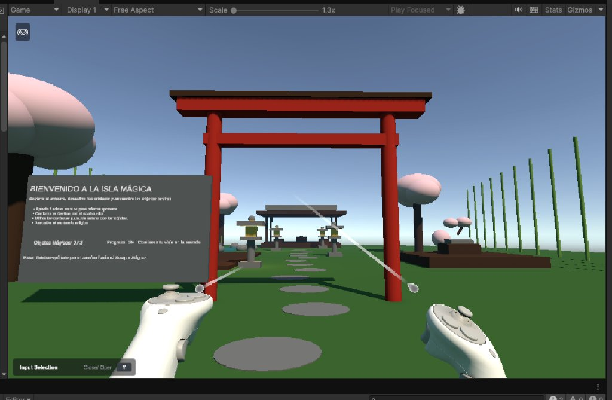
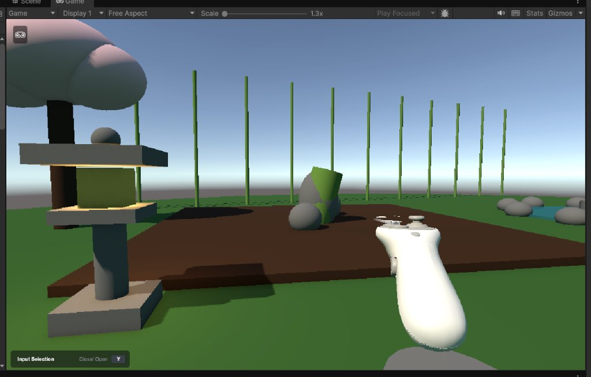
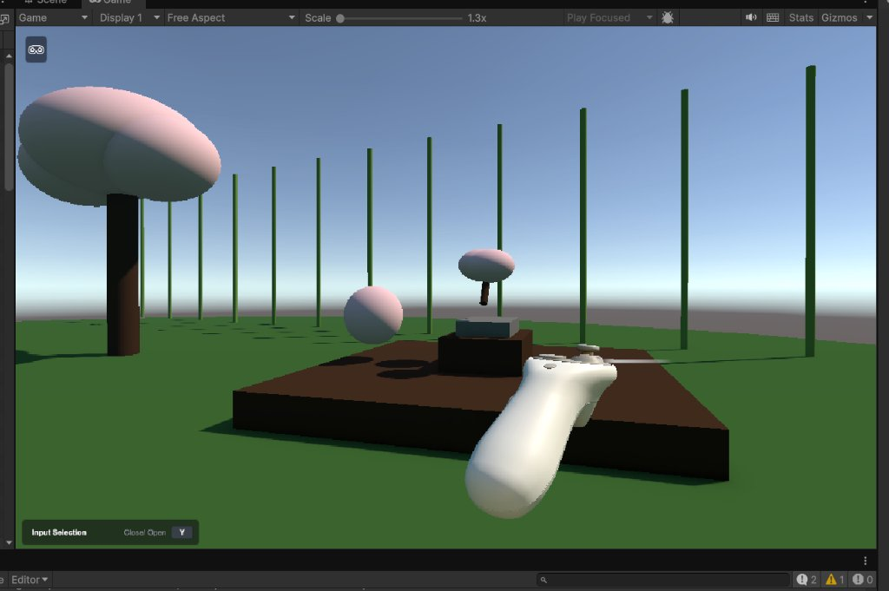
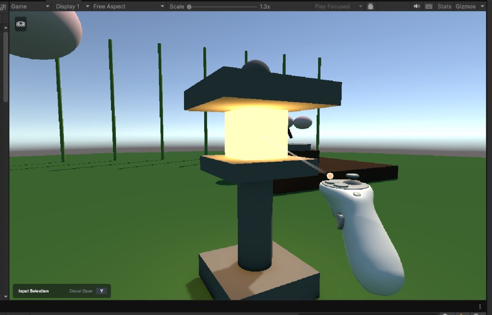
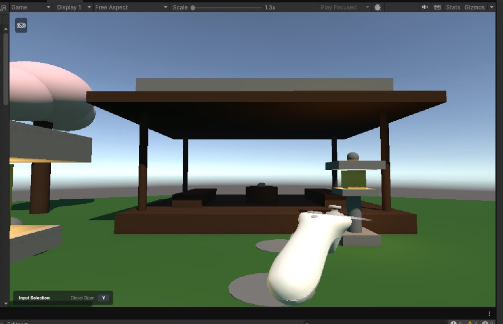

# Zen Garden VR: Jardín Zen Japonés de Kioto (Edición Interactiva)

Experiencia de Realidad Virtual inmersiva ambientada en un auténtico **Jardín Zen tradicional japonés inspirado en los templos de Kioto**, desarrollada en **Unity 6 (6000.6.8f1)** utilizando **OpenXR**, **Universal Render Pipeline (URP 17.6.0)** y **XR Interaction Toolkit 3.6.1**.

Esta edición expande significativamente el apartado visual, la composición espacial y las mecánicas interactivas del proyecto, combinando elementos arquitectónicos y naturales clásicos (Torii, Faroles Tōrō de piedra, Jardín de Arena Karesansui, Shishi-odoshi, Bonsái de cerezo y Pabellón de Contemplación) con 4 interacciones especiales de manipulación física, retroalimentación visual con resaltado emisivo y respuesta en World Space UI.

---

## 1. Galería de Capturas de la Experiencia (In-Game)

Las siguientes capturas documentan la ejecución en tiempo real en **Unity 6**, demostrando la ambientación visual, el sistema de navegación por teletransporte y las zonas del jardín:

| 1. Entrada Tradicional con Torii y Tablón de Bienvenida | 2. Jardín Seco de Arena Karesansui y Rocas Maestras |
|:---:|:---:|
|  |  |

| 3. Pabellón del Bonsái de Cerezo Sakura | 4. Avenida de Faroles de Piedra Tōrō Iluminados |
|:---:|:---:|
|  |  |

| 5. Pabellón de Té y Zona de Contemplación Zen |
|:---:|
|  |

---

## 2. Zonas del Jardín Zen de Kioto

El entorno 3D ha sido diseñado bajo una paleta cromática orgánica y armoniosa (verde musgo, arena beige rastrillada, madera oscura envejecida, piedra gris de Kioto y detalles en rojo bermellón tradicional):

1. **Zona 1: Entrada Tradicional con Torii:**
   * Portal Torii tradicional japonés en rojo bermellón con vigas Kasagi y Nuki.
   * Sendero central con losas de piedra (*Tobi-ishi*) conectando todas las áreas.
   * Tablón de madera rústica con Canvas en World Space a un lado del sendero.
2. **Zona 2: Jardín de Arena Karesansui (Jardín Seco):**
   * Delimitado por un marco perimetral de vigas de madera oscura.
   * Cama de arena con ondulaciones y surcos concéntricos rastrillados.
   * Composición de rocas maestras en equilibrio armónico (*Sanzon Iwagumi*).
   * **Interacción Especial 1:** Piedra sagrada interactiva con agarre físico (`XRGrabInteractable`) y acople magnético en el círculo sagrado de contemplación.
3. **Zona 3: Pabellón de Bonsái Centenario:**
   * Plataforma de madera elevada con mesa de exposición y maceta de cerámica.
   * **Interacción Especial 2:** Bonsái de Sakura (cerezo en flor) con sutil balanceo ante la brisa y activación de contemplación.
4. **Zona 4: Avenida de Faroles Tōrō:**
   * Cuatro faroles tradicionales tallados en piedra distribuidos a lo largo del recorrido.
   * **Interacción Especial 3:** Farol Tōrō interactivo con encendido/apagado permanente de luz cálida puntual y núcleo emisivo.
5. **Zona 5: Estanque de Piedras y Fuente Tsukubai (Shishi-odoshi):**
   * Estanque con agua translúcida y reflexiones en tiempo real en URP.
   * Borde perimetral delimitado con rocas naturales de río.
   * **Interacción Especial 4:** Fuente ritual de bambú que permite alternar el flujo del agua y su sonido relajante.
6. **Zona 6: Pabellón de Contemplación y Té:**
   * Plataforma espaciosa con cubierta de tejas japonesas pagoda.
   * Bancos de madera y mesa ceremonial con cuenco de té para meditación.
7. **Vegetación Perimetral:**
   * Bosque denso de cañas de bambú natural y árboles de cerezo Sakura en floración.

---

## 3. Sistema de Interacciones VR (4 Mecánicas Implementadas)

Todas las interacciones cuentan con **resaltado visual al apuntar (`ObjectHighlight.cs`)**, **inspección con ficha descriptiva en la UI (`ObjectSelectionManager.cs`)** y respuesta táctil/sonora:

| Elemento | Componente XR | Tipo de Interacción | Mecánica y Respuesta |
|---|---|---|---|
| **Piedra Sagrada Zen** | `XRGrabInteractable` | Direct / Ray Grab | Agarre físico con gravedad. Al soltarla dentro del círculo sagrado en la arena, se acopla suavemente, emite sonido armónico y actualiza el contador. |
| **Farol de Piedra Tōrō** | `XRSimpleInteractable` | Ray / Direct Trigger | Apuntando con el rayo y pulsando el gatillo / clic, conmuta el encendido y apagado de la luz ámbar cálida y el núcleo incandescente. |
| **Bonsái de Sakura** | `XRSimpleInteractable` | Ray / Direct Trigger | Al seleccionarse, reproduce campanilla zen, despliega el mensaje de contemplación en el tablón y balancea sus ramas orgánicamente. |
| **Fuente Tsukubai** | `XRSimpleInteractable` | Ray / Direct Trigger | Al activarse, bascula la caña de bambú y alterna el flujo de agua del estanque. |

---

## 4. Navegación en Realidad Virtual y Confort Anti-Náuseas

- **Locomoción Principal:** Teletransporte parabólico instantáneo configurado en 19 zonas y losas (`TeleportationArea`).
- **Giro Discreto (Snap Turn):** Rotación angular instantánea fijada a 45° para prevenir la cinetosis y el mareo en VR.
- **Transición y Orientación:** Mantiene la orientación vertical del usuario (`MatchOrientation.WorldSpaceUp`).
- **XR Interaction Simulator:** 100% operativo para pruebas en Editor de Unity usando teclado y ratón.

---

## 5. Interfaz Gráfica en VR (World Space UI)

Tablón de madera natural integrado ergonómicamente a la entrada del jardín (sin bloquear el paso bajo el Torii):
- **Título Zen:** "JARDÍN ZEN DE KIOTO".
- **Objetivo:** Instrucciones de relajación y contemplación en el entorno.
- **Ficha Dinámica del Objeto:** Muestra el nombre, descripción cultural y controles del elemento al que se apunta con el rayo.
- **Contador de Armonía:** Registra el avance de elementos descubiertos `(0 / 4)`.
- **Feed de Notificaciones:** Mensajes efímeros que confirman cada interacción realizada.

---

## 6. Especificaciones Técnicas

- **Motor:** Unity 6000.6.8f1 (Unity 6).
- **Render Pipeline:** Universal Render Pipeline (URP 17.6.0).
- **XR Framework:** XR Interaction Toolkit 3.6.1 & XR Core Utils 2.6.0.
- **XR Provider:** OpenXR Plugin 1.18.0.
- **Input System:** Unity Input System 1.20.1 con Action-Based Controllers.
- **Audio & UI:** UGUI 2.6.0 con TextMesh Pro.

---

## 7. Estructura de Scripts y Organización

```
Assets/
  Scenes/
    MainVRScene.unity                    <-- ESCENA PRINCIPAL JARDÍN ZEN
    MainVRScene_MagicalIsland_Backup.unity
  Scripts/
    Interactions/
      ObjectHighlight.cs                 <-- Resaltado visual emisivo al apuntar
      ObjectSelectionManager.cs          <-- Envío de nombres y fichas descriptivas a la UI
      ZenStoneInteraction.cs             <-- Agarre físico y acople en círculo de arena
      BonsaiInteraction.cs               <-- Activación y contemplación del bonsái
      LanternInteraction.cs              <-- Encendido y apagado de faroles Tōrō
      FountainInteraction.cs             <-- Control de flujo de la fuente Tsukubai
      VRInteractionUI.cs                 <-- Panel World Space informativo
    Environment/
      AmbientAudioController.cs          <-- Audio ambiental relajante
      EnvironmentEffects.cs              <-- Movimiento orgánico y efectos de entorno
      WaterController.cs                 <-- Efectos de agua en estanque
  Materials/ZenGarden/
    M_ZenSand.mat                        <-- Arena rastrillada Karesansui
    M_ZenMoss.mat                        <-- Césped verde musgo tradicional
    M_ToriiRed.mat                       <-- Bermellón tradicional japonés
    M_ZenWoodDark.mat                    <-- Madera oscura envejecida
    M_ZenBamboo.mat                      <-- Cañas de bambú natural
    M_ZenStoneGray.mat                   <-- Piedra gris de Kioto
    M_SakuraPink.mat                     <-- Pétalos y copa de flor Sakura
    M_ZenWaterPond.mat                   <-- Agua translúcida
    M_ZenLanternFlame.mat                <-- Núcleo de llama cálida
    M_ZenWhitePebble.mat                 <-- Guijarros blancos de río
  Editor/
    ZenGarden/ZenGardenBuilder.cs        <-- Generador procedimental de la escena
```

---

## 8. Instrucciones de Ejecución y Controles

1. Abrir el proyecto en **Unity 6000.6.8f1**.
2. En la ventana **Project**, abrir la escena `Assets/Scenes/MainVRScene.unity`.
3. Presionar **Play (▶)**:

### Con Visor VR (Meta Quest 2 / 3 / Pro, HTC Vive, Valve Index):
* **Teletransporte:** Mover el joystick hacia adelante para activar la parábola y soltar para teletransportarse.
* **Giro:** Mover el joystick derecho hacia los lados para rotar 45° a la vez (Snap Turn).
* **Interactuar:** Apuntar con el rayo blanco a faroles, bonsái o fuente y pulsar el gatillo (**Trigger**).
* **Agarrar la Piedra Zen:** Acercar la mano a la piedra o apuntarla y presionar el botón lateral (**Grip**). Llevarla sobre el círculo de arena y soltar el Grip.

### En PC mediante XR Interaction Simulator (Teclado y Ratón):
* **Mirar alrededor:** Mantener presionado el **Botón Derecho del Ratón** y moverlo.
* **Teletransporte:** Mantener pulsada la tecla **`B`**, apuntar al suelo o piedras y soltar / hacer clic izquierdo.
* **Rotar cámara:** Teclas **`Q`** y **`E`** (giro de 45°).
* **Apuntar con el mando:** Mantener pulsada la tecla **`Shift Izquierdo`** y mover el ratón para apuntar el rayo hacia los objetos.
* **Interactuar:** Con `Shift Izquierdo` apuntando al objeto, hacer **Clic Izquierdo** (Farol, Bonsái, Fuente).
* **Agarrar Piedra:** Apuntar a la piedra zen con `Shift Izquierdo` y mantener presionada la tecla **`G`** (Grip). Moverla y soltar `G` sobre el círculo de arena.
